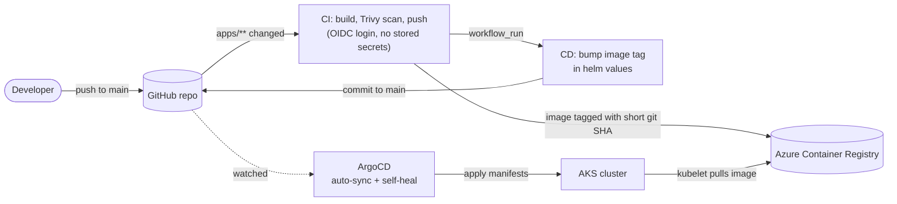
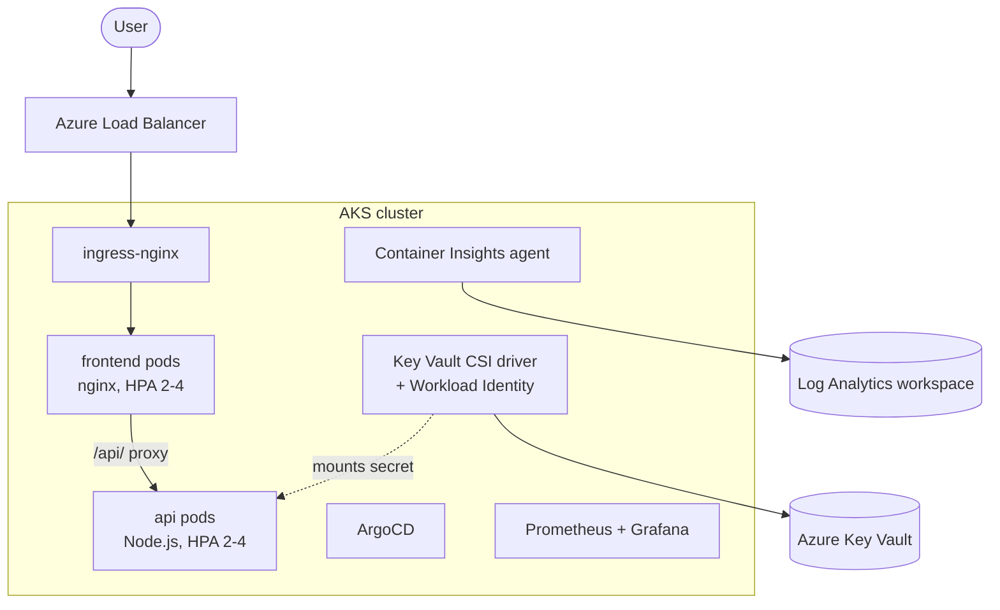

# azure-microservices-demo

Azure DevOps portfolio project built by **[Karan Pulipati](https://www.linkedin.com/in/karan-pulipati)**.
Two small Node.js services on **AKS**, delivered with **Terraform**, **GitHub Actions** and **ArgoCD (GitOps)**, with secrets from **Key Vault via Workload Identity**, **autoscaling**, and **Prometheus/Grafana + Container Insights** monitoring. It is the Azure counterpart to [aws-microservices-demo](https://github.com/karanpulipati-09/aws-microservices-demo).

The application is deliberately tiny. The point of the project is the platform and the delivery pipeline around it.

## Architecture

### Delivery pipeline (code push to running pods)



CI never talks to the cluster and holds no cluster credentials. Its only hand-off to CD is a Git commit. ArgoCD runs inside the cluster, pulls from Git, and keeps the cluster equal to what Git says.

### Runtime



## What this demonstrates

| Area | What is in the repo |
|---|---|
| Infrastructure as code | Terraform for AKS, ACR, VNet, Key Vault, managed identity, Log Analytics, ArgoCD and ingress-nginx; remote state in a separate storage account |
| GitOps | ArgoCD Applications with auto-sync, prune and self-heal; manual edits to the cluster are reverted in about a second |
| CI/CD without stored secrets | GitHub Actions authenticates to Azure with OIDC federation, so there are no client secrets or registry passwords in GitHub |
| Least privilege | Scoped RBAC on the pipeline identity; ACR admin user disabled; `restricted` Pod Security Standard; default-deny NetworkPolicy; per-app service accounts |
| Secrets management | Key Vault secret mounted into the api pod through the Secrets Store CSI driver, authenticated with Workload Identity (no credentials stored anywhere) |
| Autoscaling and availability | HPA (2-4 pods, 70% CPU) and a PodDisruptionBudget on both services |
| Observability | Container Insights into Log Analytics, plus kube-prometheus-stack (Prometheus and Grafana) deployed by ArgoCD |
| Supply chain | Every image is Trivy-scanned (CRITICAL/HIGH) and tagged with the git SHA, never `latest` |

## Load test result

A 10-minute test from an in-cluster load generator ([fortio](https://github.com/fortio/fortio)) against the frontend, which proxies to the api:

- 871,752 requests at about 1,450 requests/second, 99.997% successful
- Median latency 15 ms, p99 545 ms
- The frontend scaled from 2 to 4 pods within about a minute, then the api followed once its own CPU crossed the 70% target; both scaled back to 2 about 5 minutes after the load stopped

## Repository layout

```
apps/            frontend (static page + nginx proxy config) and api (Node.js) with Dockerfiles
helm/            one chart per service: deployment, service, HPA, PDB, ingress, SecretProviderClass
argocd/          ArgoCD Application manifests: frontend, api, monitoring
k8s/             namespaces + Pod Security labels, service accounts + RBAC, NetworkPolicies
terraform/       all Azure infrastructure
.github/workflows/  CI, CD, and Terraform plan/apply/destroy
bootstrap/       one-time OIDC app registration notes
docs/            AWS-to-Azure resource mapping and setup notes
```

## Infrastructure

| Resource | Purpose |
|---|---|
| Resource group `rg-aks-staging` | Holds all app infrastructure and is safe to destroy |
| AKS cluster | 2 x `Standard_D2s_v7`, Azure CNI, OIDC issuer and Workload Identity enabled |
| ACR | Private registry; the AKS kubelet identity has `AcrPull`, the pipeline identity has `AcrPush` |
| Key Vault | RBAC mode; holds the demo secret read by the api pod |
| User-assigned identity | Federated to the `api` service account; has `Key Vault Secrets User` on the vault |
| Log Analytics workspace | Backing store for Container Insights |
| ArgoCD and ingress-nginx | Installed by Terraform (`helm_release`) |
| Terraform state | Separate resource group and storage account, created once by hand, so it survives every destroy |

## CI/CD workflows

| Workflow | Trigger | What it does |
|---|---|---|
| `build-push.yml` (CI) | Push to `main` touching `apps/**`, or manual | Builds both images in parallel, Trivy scan, pushes to ACR over OIDC |
| `deploy.yml` (CD) | CI success, or manual | Bumps `image.tag` in `helm/*/values.yaml` and commits to `main`; ArgoCD syncs it |
| `terraform-plan.yml` | Pull request touching `terraform/**` | `terraform plan` |
| `terraform-apply.yml` | Push to `main` touching `terraform/**`, or manual | `terraform apply` |
| `terraform-destroy.yml` | Manual | Destroys the app infrastructure to avoid idle cost |

## Getting started

Full walkthrough: **[DEPLOYMENT_STEPS.md](DEPLOYMENT_STEPS.md)** (OIDC app registration, role grants, state backend, first apply).

After `terraform apply`, bootstrap GitOps once per fresh cluster:

```bash
az aks get-credentials --resource-group rg-aks-staging --name aks-staging --overwrite-existing
kubectl apply -f k8s/namespaces-podsecurity.yaml
kubectl apply -f k8s/serviceaccounts-rbac.yaml
kubectl apply -f k8s/networkpolicy-default-deny.yaml
kubectl apply -n argocd -f argocd/frontend.yaml
kubectl apply -n argocd -f argocd/api.yaml
kubectl apply -n argocd -f argocd/monitoring.yaml
```

After a destroy and recreate, the managed identity gets a new client ID. Update `keyVault.clientId` in `helm/api/values.yaml`:

```bash
az identity show -g rg-aks-staging -n id-api-workload --query clientId -o tsv
```

### Reaching the tools

ArgoCD and Grafana are ClusterIP only. Use a port-forward:

```bash
kubectl port-forward -n argocd svc/argocd-server 8443:443        # https://localhost:8443
kubectl port-forward -n monitoring svc/monitoring-grafana 3000:80  # http://localhost:3000
```

The app itself is served on the ingress-nginx load balancer IP:

```bash
kubectl get svc -n ingress-nginx ingress-nginx-controller
```

## Lessons learned

- A brand-new Azure subscription registers only a few resource providers. A missing one (Storage, ContainerService, KeyVault and others) can surface as a misleading `SubscriptionNotFound`. Register them with `az provider register`.
- GitHub's OIDC subject claim now includes immutable owner and repo IDs. A federated credential written in the old `repo:owner/repo:...` format fails with `AADSTS700213`.
- A VM quota and a VM SKU allow-list are separate restrictions. The error from a real apply lists the allowed SKUs, which is more reliable than quota output.
- With an HPA, omit `replicas` from the Deployment. Otherwise ArgoCD self-heal keeps resetting the replica count.
- ArgoCD 2.12 does not know a Deployment status field added in Kubernetes 1.36, which breaks diffing for apps using server-side apply. The monitoring app ignores Deployment `/status` to work around it.
- Every recreated AKS cluster gets a new random API FQDN, so an old kubeconfig context fails DNS lookup until you re-run `az aks get-credentials --overwrite-existing`.

## Limitations and next steps

- No cluster autoscaler: the trial subscription caps regional vCPU at 4, which is exactly the two nodes. Production would add node autoscaling.
- The Key Vault secret is a placeholder that demonstrates the mechanism. There is no real database or third-party credential behind it.
- HTTP only; no custom domain or TLS yet (cert-manager would be the next step).
- Prometheus keeps 2 days of data in the pod, with no persistent volume.
- One environment (`staging`). Per-environment values files would be the next structural step.

## Cost

Built on an Azure free-trial subscription. The cluster costs a few hundred rupees per day while running, so it is destroyed between sessions with the `terraform-destroy.yml` workflow. The Terraform state resource group is kept.
